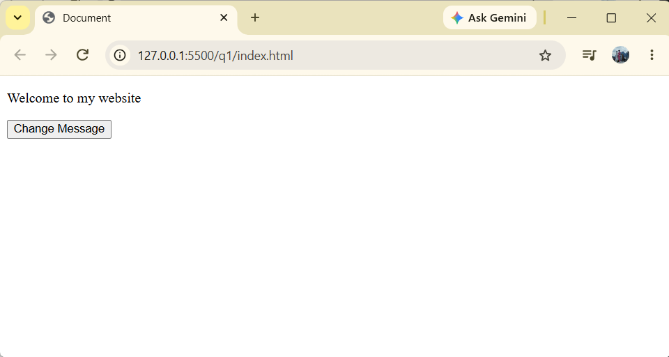
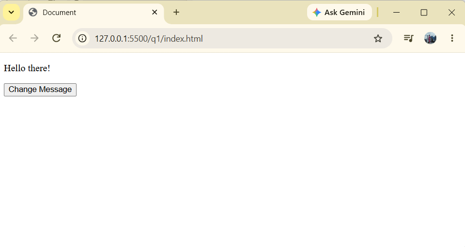
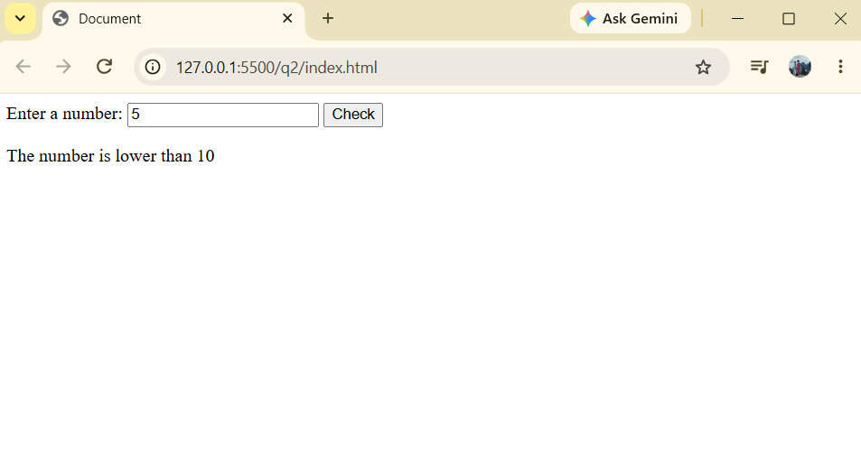
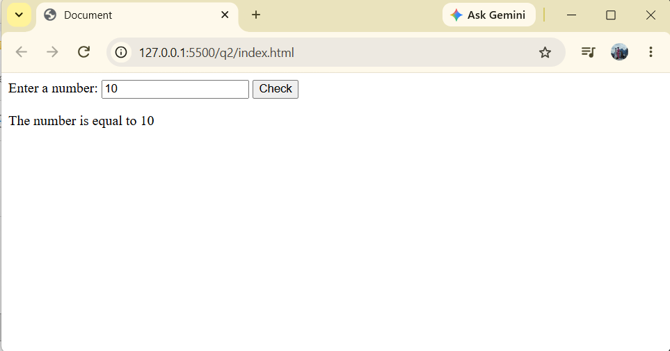
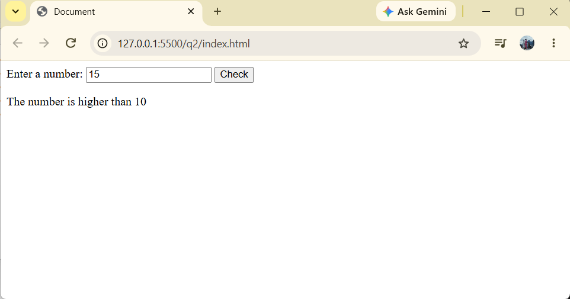
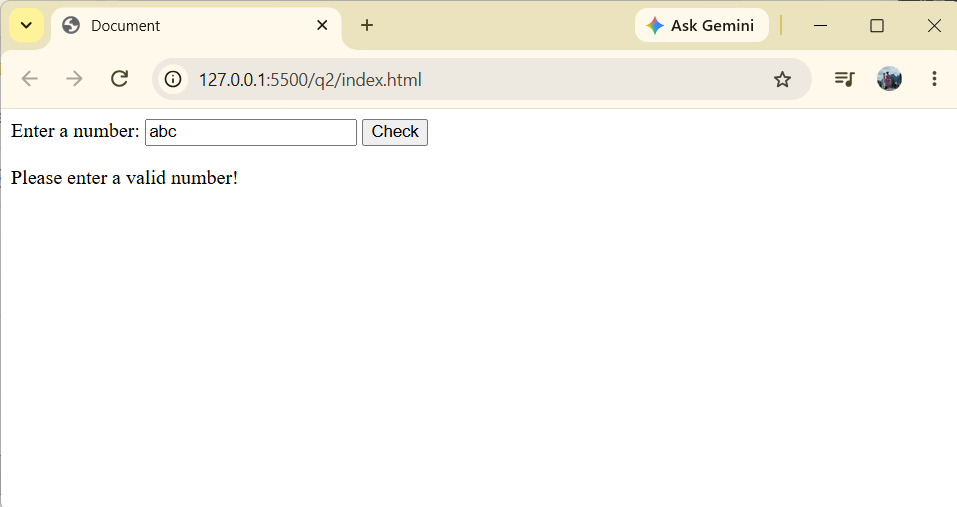
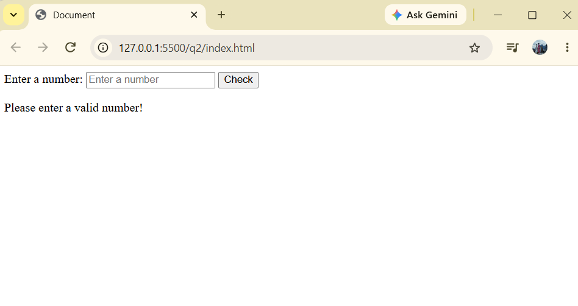
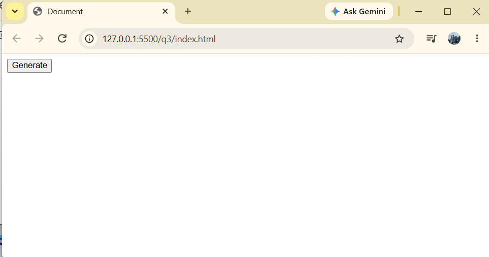
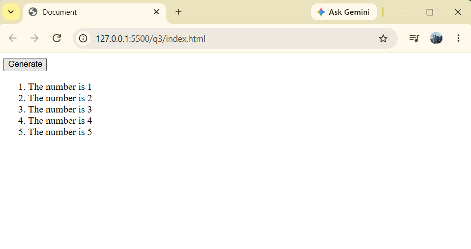

# BIC21203 Lab 4a: Client-Side Scripting (JavaScript)

**Name:** Tan Jia Hong
**Student ID:** AI250230

## Overview
This repository contains three small web pages built with HTML5 and plain JavaScript (no external libraries). They demonstrate functions, event handling (`addEventListener`), conditions, input validation, `for` loops and DOM manipulation. User-facing text is written with `textContent`, not `innerHTML`.

## Question 1: Interactive Text Changer
**Explanation:** The page shows "Welcome to my website!". The paragraph and button are selected with `document.getElementById()`. The function `changeMessage()` replaces the paragraph text with "Hello there!", and it is attached to the button with `addEventListener("click", ...)`.

**How to run:** Open `q1/index.html` in a web browser and click **Change Message**.

**Output screenshots:**

| Before click | After click |
|---|---|
|  |  |

## Question 2: Smart Number Validator
**Explanation:** The function `checkInput()` reads the input and removes surrounding spaces with `trim()`. Empty or whitespace-only input is invalid. Valid text is converted with `Number()`, and invalid values such as `abc` (`NaN`) are detected with `isNaN()`. An `if...else if...else` structure then displays one of four messages in `#result` using `textContent`. Decimal numbers such as 10.5 are valid.

**How to run:** Open `q2/index.html`, type a value and click **Check**.

**Test cases and screenshots:**

| Input | Expected message | Screenshot |
|---|---|---|
| 5 | The number is lower than 10 |  |
| 10 | The number is equal to 10 |  |
| 15 | The number is higher than 10 |  |
| abc | Please enter a valid number! |  |
| (empty) | Please enter a valid number! |  |

## Question 3: Dynamic Number Generator
**Explanation:** The function `generateNumbers()` first clears the list so repeated clicks do not create duplicates. A `for` loop from 1 to 5 then creates each `<li>` with `document.createElement()`, sets its text with `textContent` ("The number is 1" to "The number is 5") and appends it to `#numberList` with `appendChild()`.

**How to run:** Open `q3/index.html` and click **Generate**. Click it several times to confirm there are no duplicates.

**Output screenshots:**

| After one click | After repeated clicks |
|---|---|
|  |  |

## Technologies

- HTML5
- JavaScript (ES6), run in a current desktop browser